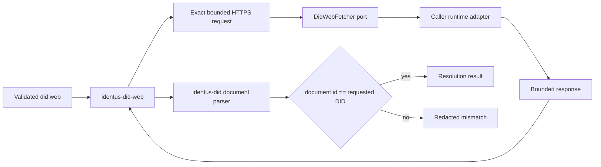

# Portable did:web profile

Issue [#559](https://github.com/hyperledger-identus/sdk-rust/issues/559)
owns the first `identus-did-web` profile. [ADR 0190](../adr/0190-bind-did-web-to-an-injected-fetch-port.md)
fixes the effect boundary; the pinned W3C CCG draft fixes URL mapping and exact
document correlation.

## Ownership

The core owns method syntax, deterministic URL derivation, representation
negotiation, cache-bypass signaling, response-envelope
validation, generic DID document parsing, and exact ID binding. The adapter
owns DNS, private-network and SSRF rules, TLS roots and versions, redirects,
proxy, connection/read limits, cancellation, cache, retry, privacy, and
telemetry. A resolver calls the port at most once.

## First profile

- lowercase ASCII multi-label FQDNs only;
- optional uppercase `%3A` port in `1..=65535`, excluding noncanonical 443;
- optional non-empty ASCII DID `idchar` colon-separated path segments, with
  percent escapes and `~` excluded by the first profile;
- bare domain maps to `/.well-known/did.json`;
- path maps to slash-separated segments followed by `/did.json`;
- response status is 200 with a bounded, syntactically valid DID JSON or
  ordinary JSON media type; only an actual 404 is classified as `notFound`,
  while other non-success statuses remain transient/internal failures;
- resolver output honors the requested representation: JSON-LD requires
  `application/did+ld+json` and a document context, while DID JSON also accepts
  the legacy `application/json` response type;
- response body passes the existing duplicate-safe bounded DID parser;
- returned document `id` equals the exact requested DID.

IP literals and numeric URL-parser aliases, single-label hosts, IDNA conversion,
arbitrary percent decoding,
dot/empty path segments, concrete transports, registration, update,
deactivation, persistence, bindings, and trust decisions are outside the first
profile. `expandRelativeUrls=true` is rejected as unsupported until a separate
bounded expansion capability is specified.

## Adapter recipe

1. Receive `DidWebRequest`; allow only its exact HTTPS URL, send its exact
   `accept()` value, and honor `no_cache()` in runtime-owned caches.
2. Apply product SSRF, DNS, TLS, redirect, proxy, privacy, timeout,
   cancellation, retry, cache, and telemetry policy.
3. Stop reading at `max_response_body_bytes()`.
4. Return status, media type, and bytes through `request.response(...)`.
5. Do not place network diagnostics or response content in public errors.

The deterministic E2E in `crates/did-web/tests/fetch_port_e2e.rs` implements
this public port in memory and proves the same composition path without a live
network or runtime-specific dependency.
