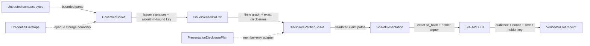

# Bounded RFC 9901 SD-JWT engine

Status: experimental and unpublished. Owner: issue #568. Decision: ADR 0193.

## Purpose and responsibility

`identus-sd-jwt` owns the stable RFC 9901 compact base format. It is a focused
credential-format engine, not a wallet, VC profile, protocol runtime, or policy
service. The engine reuses SDK JOSE and cryptography capabilities rather than
adding another signing stack.

The state transitions consume their prior state. Materialized claims appear
only after issuer verification and disclosure processing. A presentation
contains only the deterministic transitive disclosure closure needed for the
selected claims. Cleartext claims are valid selections and add no disclosure;
a clear child inside a disclosed parent includes the parent disclosure.

## Limits and effects

All untrusted entry points use one validated `SdJwtLimits` profile covering
compact bytes, JWS segments, JSON bytes/depth/nodes/members, disclosure counts
and sizes, selected paths, decoys, retained output, salts, audience/nonce, and
aggregate work. Duplicate JSON members, duplicate disclosures, digest
collisions, ambiguous references, unused disclosures, reserved claims, and
limit exhaustion fail closed with static redacted error codes.

Issuer and holder signers, secure randomness, verification keys, time,
audience, nonce, and signature-suite registries are injected. The engine does
not read clocks, open sockets, resolve DIDs, store replay state, or select trust
anchors.

## Evidence map

| Evidence | Route | Claim |
|---|---|---|
| Public E2E | `cargo test -p identus-sd-jwt --test offline_journey` | issue → envelope → verify → select → bind → verify works without network or hidden global state |
| RFC and differential | `cargo test -p identus-sd-jwt --test conformance` | official disclosure bytes/digests and two immutable oracle packets agree |
| Deterministic properties | `cargo test -p identus-sd-jwt --test properties` | nested round trips, minimal closure, ordering, arrays, and salt boundaries hold across a bounded sweep |
| Rejections | `cargo test -p identus-sd-jwt --test rejections` | malformed, duplicate, collision, graph, resource, and redaction cases fail closed |
| Fuzz | `nix develop .#fuzz --command ./scripts/fuzz-sd-jwt.sh soak` | compact ingress and generated full journeys remain bounded and panic-free |
| Directional benchmark | `cargo bench -p identus-sd-jwt --bench directional` | ordinary processing and early oversized rejection have a repeatable local baseline |

The immutable oracle evidence and disagreement ledger live under
`docs/conformance/fixtures/sd-jwt-rfc9901/v1/`. Cross-target compilation is
evidence of portability only; it is not a runtime, packaging, or certification
claim.

## Deliberate exclusions

- SD-JWT VC media types, VCT rules, status, and profile versions;
- JWS JSON Serialization;
- HTTP, OID4VC transport, DID resolution, trust, replay, and authorization;
- persistence, custody, key lifecycle, FFI and language bindings;
- publication, certification, and downstream repository mutation.

Those capabilities require separately versioned specifications and issues. The
next profile slice is issue #569 and remains blocked until this base engine is
accepted.
